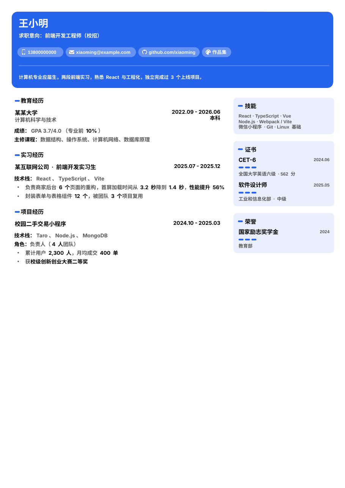

# blue-resume-pptx

把简历内容（一份 JSON）生成**单页 A4、可编辑的 PowerPoint 简历**。版式是蓝色顶栏，左栏放经历，右栏放技能卡片。仓库里同时附带一个 Claude 技能：把零散素材交给 Claude，它会先问清缺的信息，再写成 JSON，最后直接出 .pptx。

为什么用 PPT 做简历：Word 里图片乱跑、表格错位，PPT 可以自由排版，导出 PDF 后和 Word 做的没有区别。



> 预览图是在 Linux 上用替代字体渲染的。在装有黑体和微软雅黑的 Windows 上打开，字体效果以 PowerPoint 实际显示为准。示例人物「王小明」是虚构的。

## 特点

- **全部可编辑**：每个板块都是真正的文本框，要点是带项目符号的列表，日期右对齐，联系方式胶囊可以点击（邮箱、GitHub、作品集）。
- **自动排版，保证一页**：放不下时按顺序处理：先把教育、证书这类短板块挪到右栏；再收紧行距和间距；最后把字号降到 8.5 号、8 号。实在放不下会提示超出几行。
- **数据自动加粗**：90 人、56%、$2.5M、3x 这类数字会自动加黑加粗；年份、月份、型号不加粗。重点短语用 `**...**` 手动标出。
- **中英文自动识别**：中文用黑体，英文用 Arial 并按单词换行。
- **可换主色**：一个 `theme` 字段，卡片底色会自动跟着变浅。

## 快速开始

需要 Node.js 18 或以上版本。

```bash
npm install
npm run example                                  # 生成 examples/zh_campus.pptx
npm run build -- 你的数据.json 输出文件名.pptx      # 用自己的数据生成
```

脚本会输出一行 JSON，说明生成结果：

```json
{"level":0,"overflowPt":0,"lang":"zh","movedToRight":[]}
```

- `level`：压缩档位，0 表示原始版式，4 表示 8 号字。
- `overflowPt`：大于 0 表示仍然超出一页。
- `movedToRight`：自动挪到右栏的板块。

生成后在 PowerPoint 或 WPS 里打开，检查一遍，再「另存为 PDF」投递。

## 数据格式

完整说明见 [skill/blue-resume-pptx/SKILL.md](skill/blue-resume-pptx/SKILL.md)，示例见 [examples/zh_campus.json](examples/zh_campus.json)。基本结构如下：

```json
{
  "name": "姓名",
  "title": "前端开发工程师",
  "contacts": [{ "type": "phone", "text": "138xxxx" }, { "type": "email", "text": "a@b.com" }],
  "summary": "一两句个人简介",
  "photo": "photo.jpg",
  "left": [
    { "title": "实习经历", "entries": [
      { "name": "公司 · 职位", "date": "2025.07 - 2025.12",
        "details": ["技术栈：React、TypeScript"],
        "bullets": ["要点，**重点**会加粗"] }
    ]}
  ],
  "right": [
    { "title": "技能", "tags": ["React", "TypeScript"] },
    { "title": "证书", "items": [{ "name": "CET-6", "date": "2024.06", "content": "562 分" }] }
  ]
}
```

## 作为 Claude 技能使用

把 `skill/blue-resume-pptx` 整个文件夹放进 Claude 的技能目录（例如 Claude Code 的 `~/.claude/skills/`），然后在仓库根目录执行一次 `npm install`。之后直接对 Claude 说「帮我做一份简历 PPT」，并附上旧简历或零散信息。技能会：

1. 提取信息，把缺的内容一次问清楚，并按岗位追问常见缺口：证书、量化成果、技术栈、成绩；
2. 如果你附上了 JD，先做一份匹配分析；
3. 内容超出一页时，先给出精简方案，你确认后再删；
4. 生成 .pptx 并检查渲染效果。

技能要求 AI 不编造经历和数字。凡是涉及事实的改写，都会先问你。

## 隐私提示

请不要把自己的真实简历数据和照片提交到公开仓库。可以把它们放在 `private/` 目录下，这个目录已经加入 `.gitignore`。

## 许可证

MIT
